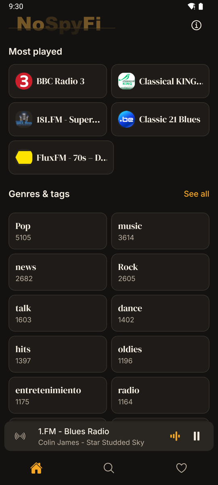
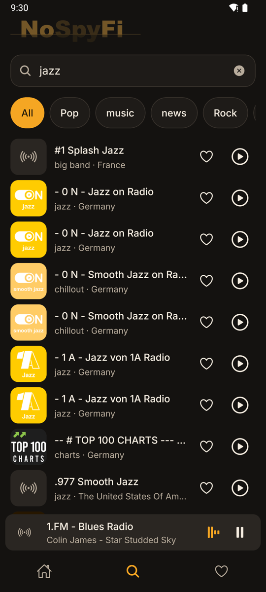
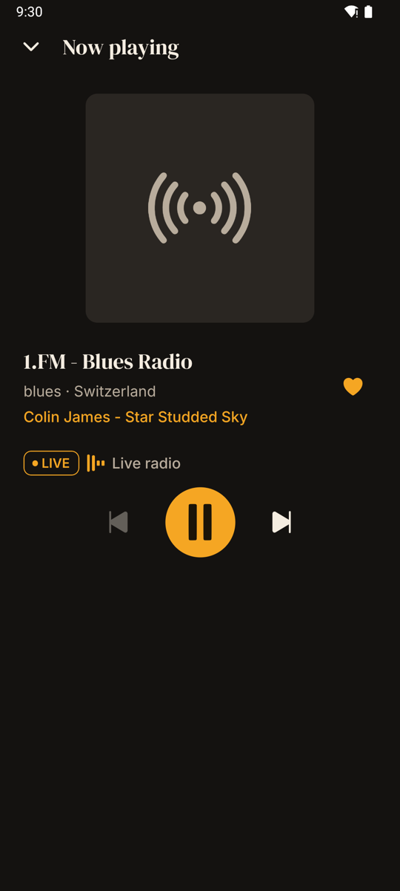
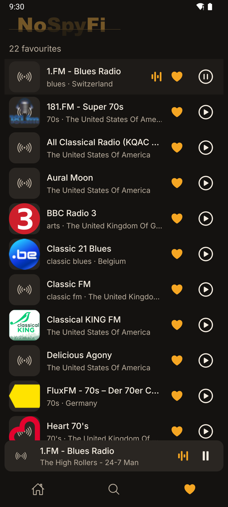
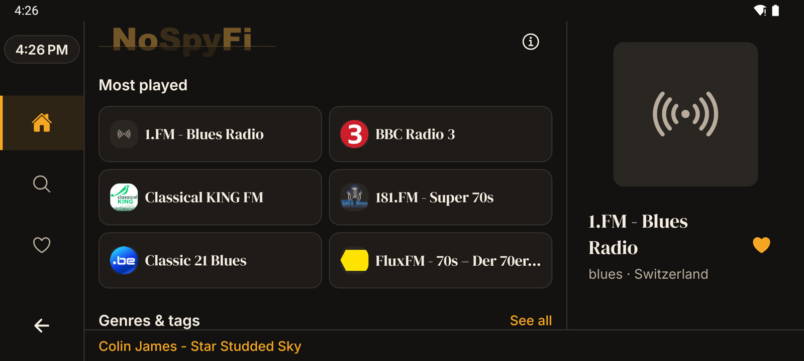

<p align="center">
  
</p>

<h1 align="center">NoSpyFi</h1>

<p align="center">
  <strong>Tens of thousands of internet radio stations. No account, no ads, no tracking.</strong><br>
  A free, open-source radio player for Android phones, tablets and car head units.
</p>

<p align="center">
  <a href="https://github.com/cuginoAle/web-radio/releases">Download</a> ·
  <a href="#privacy">Privacy</a> ·
  <a href="#honest-limits">Limits</a> ·
  <a href="#for-developers">Build it yourself</a>
</p>

<p align="center">
  
  
  
  
</p>

<p align="center"><em>Find a station → listen → keep it in your favourites.</em></p>

## What it does

- **The whole directory on your phone.** One download of the community-run [Radio Browser](https://www.radio-browser.info/) catalogue, then search, genres & tags and favourites work offline. Only the audio streams. You decide when to refresh the catalogue.
- **Search by name.** Case- and accent-insensitive, instant, on the local copy.
- **Genres & tags.** Browse stations by the tags the directory gives them. They're free-form community labels, not a curated taxonomy.
- **Favourites.** Starts with 22 hand-picked stations (classical, jazz, blues, 70s, prog rock). A favourite keeps playing even if it disappears from a later catalogue.
- **Most played.** Your six favourite stations by real listening time, counted on your phone only.
- **Now playing.** The song the station announces, when it announces one. Many stations don't, or send slogans instead.
- **Background playback.** Keeps playing with the screen off, with media controls in the notification and on the lock screen.
- **Made for the car, too.** In landscape a side rail adds a clock and a *Back to apps* button that leaves the music playing, and the Android navigation bar stays out of the way.
- **Free, and it stays free.** No ads, no in-app purchases, no premium tier. GPL-3.0 licensed.

<p align="center">
  
</p>

## Privacy

No account. No sign-up. No ads. No analytics, no crash reporting, no third-party SDKs. There is no NoSpyFi server, so there's nowhere for your data to go.

Your favourites, your listening time and your copy of the catalogue live in a database on your phone and never leave it. They aren't even included in Android's cloud backup.

**Permissions:** internet and network status, background playback, audio settings, install app updates (used only when you tap *Install*). No location, microphone, camera, contacts or storage.

### What leaves your phone

| When | Who receives it | What they can see |
|---|---|---|
| You tap *Download* or *Refresh catalogue* | A [Radio Browser](https://www.radio-browser.info/) mirror (community-run, HTTPS) | Your IP address, that a NoSpyFi app downloaded the directory, and which NoSpyFi version you have |
| You play a station, or open the app after listening to one (it starts the last station again) | That station's streaming server | Your IP address and which station you're listening to, as with any radio player |
| A station logo is shown | Whoever hosts that station's logo | Your IP address |
| The station or logo uses plain HTTP (about a third do) | Anyone on the network path (Wi-Fi owner, ISP) | Which station you're listening to |
| Once a day when you open the app, if you turned on *Check for updates*, and when you tap *Install* | GitHub (Microsoft), over HTTPS | Your IP address, that a NoSpyFi app checked for or downloaded a new version, and which NoSpyFi version you have |

That's all. One caveat: each stream address is exactly what the broadcaster registered with the directory, and a few include the broadcaster's own tracking parameters. NoSpyFi passes them on unchanged, because removing them can break the stream.

Don't take our word for it: the code is open, and every directory request goes through [`src/services/radio-browser/`](src/services/radio-browser/), and the update check through [`src/services/update-check/`](src/services/update-check/).

## Honest limits

- **Android only** (7.0 or newer). No iOS version.
- **English only.**
- **Some streams won't play:** HLS streams without a `.m3u8` extension, and `.pls`/`.m3u` playlist addresses. The app shows an error.
- **Now playing is best effort:** it comes from the stream's own metadata, which many stations leave empty or fill with slogans and ads.
- **No previous/next in the notification**, only play/pause.
- **The catalogue is as good as the directory:** Radio Browser is community-maintained, so stations can be missing, mislabelled or offline. The station count describes your downloaded copy.
- **The first download takes a few tens of MB** of data. Refreshes are the same size: there is no incremental update.
- **Plain HTTP is allowed** because about a third of stations only stream that way ([ADR 0001](docs/adr/0001-global-cleartext-http.md)).
- **Not in the Play Store or F-Droid**: install with Obtainium or the APK (see [Install](#install)). Update checks are off unless you turn them on.

## Install

### With Obtainium (Android 8 or newer, recommended)

[Obtainium](https://github.com/ImranR98/Obtainium) is a free, open-source app that installs apps and their updates straight from where developers publish them.

1. Install Obtainium. Already use F-Droid or IzzyOnDroid? Install it from there. Otherwise download `app-release.apk` from [Obtainium's Releases](https://github.com/ImranR98/Obtainium/releases) (not the `fdroid` one).
2. In Obtainium, tap *Add App*, paste this address, tap *Add*, then install NoSpyFi:
   ```
   https://github.com/cuginoAle/web-radio
   ```
3. Open NoSpyFi. When it asks about checking for new versions, answer *No, I use Obtainium or update by hand*: Obtainium already tells you. Then tap *Download catalogue*.

### Without Obtainium (Android 7, or if you'd rather not)

1. On your Android device, download `NoSpyFi-<version>.apk` from [the latest release](https://github.com/cuginoAle/web-radio/releases/latest).
2. Open it and allow your browser or file manager to install apps when Android asks.
3. Open NoSpyFi. When it asks about checking for new versions, answer *Yes*, then tap *Download catalogue*.

When a new version is out, NoSpyFi shows a notice on its home screen: tap *Install*. Installing stops the radio. The first time, Android asks you to allow NoSpyFi to install apps.

On phones with Google Play, Play Protect may offer to scan NoSpyFi: *Scan app* sends the app to Google; *More details → Install without scanning* doesn't.

Updates install over the old version and keep your favourites.

## For developers

Expo / React Native app with Expo Router, SQLite and a single Zustand store. Build, signing and release in detail: [docs/build-and-release.md](docs/build-and-release.md). Domain language: [GLOSSARY.md](GLOSSARY.md). Decisions: [docs/adr/](docs/adr/). Native audio spike: [docs/spike-audio.md](docs/spike-audio.md).

### Requirements

- Node 22.13 or newer (tests use `node:sqlite`) and pnpm 11
- JDK 17 and the Android SDK with `ANDROID_HOME` set
- An Android device or emulator. **Expo Go is not enough:** background audio needs a native build

### Commands

| Command | What it does |
|---|---|
| `pnpm install` | Install dependencies |
| `pnpm android` | Generate `android/`, compile a development build and launch it on the device |
| `pnpm dev:emulator [avd]` | Boot the Android emulator if needed, install the development build on it (never on a phone) and keep Metro attached |
| `pnpm start` | Start Metro for an already-installed development build |
| `pnpm test` | Automated tests (Jest; real SQLite via `node:sqlite`) |
| `pnpm typecheck` | Type check |
| `pnpm lint` | ESLint |

### Installable release APK

```sh
pnpm build:apk    # regenerates android/ and builds dist/NoSpyFi-<version>.apk, then offers to install it
pnpm install:apk  # installs it on the single USB-connected device (emulators ignored)
```

Each build replaces the APK of the same version in `dist/`. `android/` is generated from `app.json` and not versioned. Without a release key the APK is signed with the debug keystore: fine for your own devices, not for distribution.

### Signing a release

Create the release key once, outside the repo:

```sh
keytool -genkeypair -v -storetype PKCS12 -keyalg RSA -keysize 4096 -validity 10000 \
  -alias nospyfi -keystore ~/keys/nospyfi-release.keystore
```

Then point the build at it in `.env.local` at the repo root (git-ignored, read by the build and release scripts):

```sh
NOSPYFI_KEYSTORE=/path/to/nospyfi-release.keystore
```

`pnpm build:apk` now signs with it. It asks for the password, or reads it from `NOSPYFI_KEYSTORE_PASS`.

The build prints the certificate's SHA-256 fingerprint. **Back up the keystore and its password**: every future update must be signed with the same key, and a lost key cannot be recovered. A phone with a debug-signed build has to uninstall it once before installing a release-signed one.

### Releasing an update

```sh
pnpm release
```

It asks for the release type (patch, minor or major; Enter means patch). Pass it as an argument to skip the question, or pass an exact version (`pnpm release X.Y.Z`): that's how the very first release keeps the version already in `app.json`.

The script refuses to start unless `main` is clean and level with `origin/main` and the tests, typecheck and lint pass. Then it:

1. bumps the version in `app.json` and `package.json`, and raises `versionCode` by 1 (Android refuses an update whose code is not higher);
2. builds the signed APK and offers to install it on the phone connected by USB;
3. opens `$EDITOR` for the release notes, with the commits since the last release as a draft, and asks whether to publish;
4. on *yes*, commits `chore(release): vX.Y.Z`, tags it with the notes, pushes both and publishes the GitHub Release with the APK (`pnpm release:publish`). On *no*, empty notes, a failed build or Ctrl-C, it restores the version.

It needs `gh` logged in with the release token. Details, retries and troubleshooting: [docs/build-and-release.md](docs/build-and-release.md).

Database schema changes go in a new entry at the end of `MIGRATIONS` in [src/db/migrations.ts](src/db/migrations.ts). Never edit an existing one: updates must keep users' favourites and listening time, and there is no cloud backup to restore them from.

### Structure

```
src/app/         routes only (Expo Router)
src/screens/     screen containers and their sub-components
src/components/  reusable components
src/hooks/       hooks grouped by concept
src/helpers/     pure functions (normalisation, search, player)
src/db/          SQLite schema, queries, generation writes
src/services/    Radio Browser client, catalogue refresh, audio session, startup
src/state/       the single Zustand store (ADR 0002)
src/theme/       colour, spacing and typography tokens
test/            fakes for system boundaries and the node:sqlite adapter
```

Now playing relies on a patch to expo-audio that reads ICY metadata ([ADR 0003](docs/adr/0003-patch-expo-audio-icy-metadata.md)).

## Licence and credits

NoSpyFi is free software under the [GNU General Public License v3.0 or later](LICENSE). Station data comes from [Radio Browser](https://www.radio-browser.info/). Streams, logos and broadcasts belong to their respective broadcasters.
