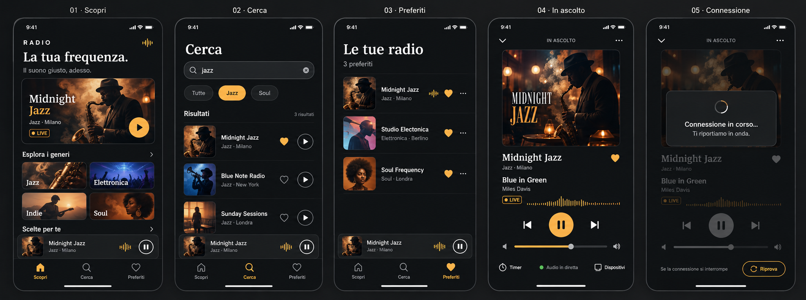
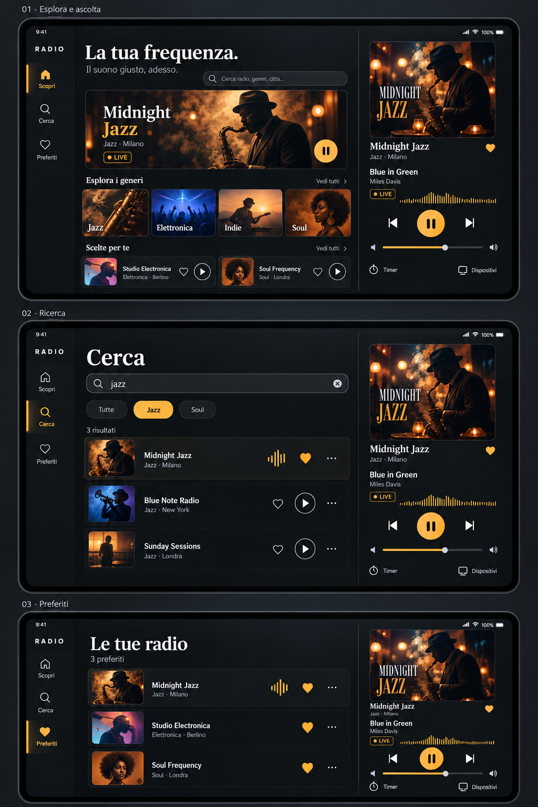

# Handover — player web radio per Android

Documento per realizzare una nuova app autonoma con React Native. Non integra né modifica l’app Works o il relativo repository web.

**Stato:** specifica di consegna; applicazione non ancora implementata.  
**Data:** 31 ottobre 2026.  
**Lingua dell’interfaccia:** italiano.

## 1. Obiettivo e decisioni approvate

Realizzare un player web radio con interfaccia professionale, moderna e coerente su smartphone Android e tablet Android in landscape.

Le decisioni confermate dall’utente sono:

- Prima versione **solo Android**.
- Layout smartphone e tablet landscape basati sui mockup allegati.
- Radio raggruppate per genere, ricerca per nome e preferiti persistenti.
- Catalogo scaricato da Internet e salvato sul dispositivo; possibilità di riscaricarlo.
- Audio in streaming: scaricare il catalogo non rende la musica disponibile offline.
- Riproduzione in background, schermo bloccato e controlli di sistema.
- **Radio Browser** come directory pubblica, accesso diretto senza backend proprietario.
- **SQLite** per catalogo, preferiti e impostazioni, conservati in tabelle distinte.
- **React Native + Expo**, build Android nativa ed **Expo Audio** per il player.

Le regole indicate come **default MVP** sono proposte operative per rendere questa specifica eseguibile; non sono ulteriori preferenze espresse dall’utente.

Fuori dalla V1: iOS, account e sincronizzazione cloud, backend proprietario, registrazione dei programmi, download della musica, pubblicità e abbonamenti. Timer e selezione dispositivi sono presenti nelle immagini ma non sono requisiti approvati: ometterli dalla V1 anziché mostrare pulsanti inattivi.

## 2. Riferimenti visivi

### Smartphone

### Tablet landscape

Le immagini stabiliscono direzione estetica e gerarchia, non dati reali. Midnight Jazz, le copertine, le città e i brani dei mockup sono esempi: non presentarli come contenuti reali del catalogo.

### Regole di implementazione visiva

- Superfici charcoal, testo caldo chiaro, ambra per selezione e azione principale; definire token condivisi per colori, spaziature, bordi e tipografia.
- Titoli editoriali serif, testo e controlli sans-serif; scegliere font disponibili o correttamente licenziati, con fallback.
- Usare componenti React Native e `StyleSheet` come default MVP. CSS Modules, Radix UI e Next.js appartengono al progetto web e non si applicano a questa app autonoma.
- Icone coerenti, etichette accessibili e bersagli tattili di almeno 48 dp. Verificare contrasto, ingrandimento del testo e TalkBack.
- Copertine remote con placeholder locale; una favicon assente o non valida non deve rompere la lista.
- Liste virtualizzate, immagini dimensionate e risultati paginati localmente: non montare l’intero catalogo.

### Layout adattivo

Smartphone: navigazione Scopri / Cerca / Preferiti in basso; mini-player sopra la navigazione; player completo apribile dal mini-player.

Tablet landscape: rail di navigazione a sinistra, contenuti al centro, player persistente a destra. Il pannello destro sostituisce il player completo separato e non duplica la sessione audio.

**Default MVP:** attivare il layout a tre colonne con larghezza disponibile almeno 900 dp, orientamento landscape e spazio sufficiente per testo ingrandito; assegnare circa un terzo dell’area utile al player. Sotto tale soglia usare il layout compatto. Questa soglia è un punto di partenza da validare, non una classificazione del dispositivo.

Rotazione e ridimensionamento devono conservare stazione, riproduzione, ricerca e tab selezionata; nessun riavvio del player. Tablet portrait può usare la struttura compatta con contenuti adattati alla larghezza.

## 3. Flussi principali e stati UI

### Primo avvio

Senza catalogo locale mostrare una schermata di benvenuto essenziale con “Scarica catalogo”, spiegazione della connessione richiesta e possibilità di iniziare il download. **Default MVP:** richiedere l’azione esplicita prima del download completo, anche su rete mobile.

Durante il download mostrare radio ricevute, stato e “Annulla”. Se il totale non è affidabile, usare un progresso indeterminato; non inventare percentuali. Prima del completamento non rendere consultabile lo staging come catalogo valido.

In caso di assenza rete, errore o annullamento senza una copia precedente: stato vuoto “Catalogo non disponibile” con “Riprova”. Non simulare risultati con le stazioni dei mockup.

### Avvii successivi e consultazione

Aprire subito l’ultima copia locale valida, senza attendere un server. Ricerca, generi e preferiti devono funzionare anche senza Internet. **Default MVP:** nessun aggiornamento automatico del catalogo in avvio o in background.

Scopri mostra accesso ai generi/tag e alle stazioni. L’elenco generale e ogni gruppo usano ordinamento alfabetico locale stabile, con UUID come spareggio. Non implementare raccomandazioni personalizzate o classifiche artificiali per riempire “Scelte per te”. La sezione può diventare “Tutte le radio”.

I tag della directory non sono una tassonomia musicale verificata. **Default MVP:** derivare i gruppi dai tag, togliendo spazi superflui, uniformando maiuscole/minuscole e deduplicando; mostrare “Generi e tag” ed evitare di assegnare generi inventati. Una stazione può appartenere a più gruppi; quelle senza tag restano accessibili in “Tutte le radio”. Conservare il valore originale per la visualizzazione quando utile.

### Ricerca e preferiti

La ricerca per nome lavora esclusivamente sul catalogo locale attivo. **Default MVP:** sottostringa, ignora maiuscole e accenti, spazi iniziali/finali rimossi; query vuota mostra l’elenco del contesto. Normalizzare nome e query con la stessa funzione Unicode. Combinare ricerca e tag selezionato con AND.

Usare parametri SQL e trattare `%`, `_` e il carattere di escape della query come testo letterale. Distinguere “Nessuna radio trovata” da un errore del database.

Il cuore aggiunge/rimuove un preferito; tutte le superfici si aggiornano coerentemente. Preferiti vuoti: messaggio e collegamento a Scopri. Nessun account richiesto. Persistenza dopo chiusura/riavvio dell’app; disinstallazione o cancellazione dei dati elimina i dati locali.

### Stati del player

| Stato | Comportamento visibile |
|---|---|
| Nessuna stazione | Nessun mini-player; invito a scegliere una radio nel pannello tablet. |
| Caricamento | Stazione selezionata e indicatore; niente falsa indicazione “in riproduzione”. |
| Riproduzione | Pausa disponibile, indicatore LIVE e informazioni reali disponibili. |
| Pausa | Play disponibile; riprendere significa tornare al flusso live, non al punto precedente. |
| Buffering | Indicazione di riconnessione; conservare contesto e possibilità di interrompere. |
| Errore | Messaggio comprensibile e “Riprova”; niente ciclo infinito di tentativi. |
| Offline | Catalogo consultabile; avvio audio spiega la necessità di Internet. |

Non fermare uno stream funzionante solo perché un rilevatore di connettività cambia stato: lo stato effettivo del player prevale. Per uno stream interrotto, **default MVP:** massimo due riconnessioni con attesa crescente; poi azione manuale “Riprova”. Pausa o cambio radio annullano i tentativi pendenti.

Se brano e artista non sono realmente disponibili, mostrare nome della radio e “Radio in diretta”. Non usare Miles Davis o altri metadati dimostrativi. Non promettere il supporto ICY senza una prova della libreria scelta. Nessuna barra di avanzamento o seek per il live.

## 4. Directory e strategia di fetch

Radio Browser è una directory comunitaria: “tutte le radio” significa tutte quelle esposte dal catalogo durante il download, non tutte le emittenti del mondo. Il servizio non offre una garanzia di disponibilità. [Sito e condizioni del catalogo](https://www.radio-browser.info/)

Usare discovery e mirror secondo le [indicazioni ufficiali d’integrazione](https://api.radio-browser.info/), con un User-Agent descrittivo dell’app. Memorizzare l’ultimo mirror valido come aiuto al bootstrap, non come server unico permanente.

Riferimenti API: elenco `/json/stations`, ricerca paginabile `/json/stations/search`, discovery `/json/servers`. L’identità della stazione è `stationuuid`; non utilizzare ID numerici del mirror. I dati includono nome, tag, paese, lingue, favicon, URL, URL risolto, codec e controlli di raggiungibilità. [Reference API](https://docs.radio-browser.info/)

**Default MVP per l’import:** pagine sequenziali da 1.000 righe, con `offset` e `limit`, nessun filtro geografico o di genere e `hidebroken=false`. Ordinamento esplicito ripetibile consentito dalla reference, evitando `random`. Continuare fino a pagina corta/vuota; avanzare l’offset per numero di righe ricevute, non per numero di UUID nuovi.

Questi valori sono parametri tecnici da profilare sul catalogo reale, non promesse di prestazione. Non scaricare immagini o provare gli stream durante l’importazione. Non eseguire un fetch per ogni stazione.

Conservare anche le stazioni con ultimo controllo negativo e indicarle come tali; non nasconderle silenziosamente. Il controllo della directory non prova che lo stream sia riproducibile sul dispositivo. Un URL non supportato resta rappresentabile nel catalogo con un errore chiaro all’avvio.

### Affidabilità del download

- Una sola sincronizzazione attiva; richieste ripetute non avviano download concorrenti.
- Validare status HTTP, risposta JSON, struttura della pagina e UUID prima dell’import; accettare campi aggiuntivi, usare fallback per campi opzionali.
- Nome assente: “Radio senza nome”; tag mancanti: nessun gruppo. Un record privo di UUID rende la pagina non valida: segnalare l’errore e non attivare una copia incompleta.
- Scrivere ogni pagina in batch brevi con parametri SQL; deduplicare per UUID all’interno della generazione.
- **Default MVP:** timeout per richiesta di 30 secondi e un solo retry transitorio sul mirror corrente, con attesa. Annullamento via segnale abort anche durante attese e tra batch.
- Se occorre cambiare mirror, ripartire dalla prima pagina in un nuovo staging: non concatenare offset di server diversi.
- Limitare i mirror provati a tre per operazione; una volta esauriti, mostrare errore e lasciare all’utente il nuovo tentativo.
- Se le pagine non progrediscono, si ripetono o la risposta diventa incompatibile, interrompere con errore anziché continuare senza limite.
- Nessuna transazione mantenuta aperta durante una richiesta di rete. Il download non deve bloccare scroll, preferiti o audio.

La paginazione con offset non è uno snapshot garantito: variazioni remote possono introdurre duplicati o omissioni durante la scansione. Deduplicazione e ordinamento riducono alcuni problemi ma non creano una garanzia di completezza puntuale. Descrivere il risultato come copia locale eventualmente coerente; non affermare che il numero ricevuto certifichi la copertura globale.

**Default MVP:** refresh completo, non sincronizzazione incrementale. Non è stato verificato un contratto completo di delta e cancellazioni. Il backup JSON giornaliero è un’alternativa da valutare solo dopo verifica di schema e dimensioni, non il meccanismo predefinito. [FAQ Radio Browser](https://www.radio-browser.info/faq)

Quando l’utente avvia una radio, notificare la scelta con `/json/url/{stationuuid}` secondo la reference. La chiamata non deve bloccare l’audio o generare retry che moltiplichino l’evento; non inviarla per download catalogo, rendering o semplice selezione visiva. [Contatore ufficiale](https://docs.radio-browser.info/#station-click-counter)

## 5. Salvataggio locale e aggiornamento atomico

### Soluzioni considerate

| Soluzione | Valutazione per questa app |
|---|---|
| **SQLite, scelta approvata** | Query e indici locali, batch e transazioni; adatto al catalogo e ai dati utente separati. |
| File JSON | Utile per prototipo/snapshot; parsing dell’intero file e filtri JavaScript aumentano memoria e costo degli aggiornamenti. |
| Archivio chiave-valore | Adatto a poche preferenze; un catalogo serializzato come valore unico non offre indici e query. Non aggiungere un secondo sistema nella V1. |

Usare [Expo SQLite](https://docs.expo.dev/versions/latest/sdk/sqlite/). L’estensione full-text è una possibile ottimizzazione futura; la ricerca per sottostringa va prima misurata sul catalogo reale.

### Modello dati minimo proposto

| Tabella | Dati e vincoli |
|---|---|
| `catalog_generations` | ID locale, stato staging/ready, inizio/fine, mirror, numero radio; nessuna identità dipendente dal server. |
| `stations` | Chiave `(generation_id, stationuuid)`; nome, chiave di ricerca, URL originale/risolto, favicon, paese/codice, lingue, codec, bitrate, ultimo controllo e data. |
| `station_tags` | `(generation_id, stationuuid, tag_key)` univoco; etichetta del tag. Relazione molti-a-molti per raggruppamenti. |
| `favorites` | `stationuuid` univoco, data aggiunta e ultimo snapshot utile: nome, URL, favicon, paese. Nessuna FK con cancellazione a cascata dal catalogo. |
| `app_metadata` | Generazione attiva, ultimo aggiornamento riuscito, conteggio attivo, versione schema e poche impostazioni. |

Indici iniziali sui tag e sulla relazione con la generazione; accesso per UUID. Verificare il piano delle query e la ricerca su dati reali prima di aggiungere altri indici. La ricerca `%termine%` non diventa automaticamente efficiente grazie a un semplice indice B-tree sul nome.

Trattare i metadati remoti come testo, non HTML. Validare URL e schema prima di aprirli nel player; niente esecuzione di markup, SQL o istruzioni ricavate dal catalogo. Non salvare token o credenziali di servizi esterni nei log.

### Protocollo di attivazione

1. Aprire una nuova generazione staging, lasciando invariato il puntatore alla generazione attiva.
2. Importare e validare le pagine con transazioni locali brevi. Mostrare il numero di UUID unici importati.
3. A download finito verificare integrità, schema atteso, riferimenti tag e catalogo non vuoto; una risposta anomala non sostituisce una copia valida.
4. In una transazione breve marcare la nuova generazione ready, cambiare il puntatore attivo e aggiornare data/conteggio del successo.
5. Le nuove query leggono la generazione attiva; invalidare i risultati UI precedenti senza perdere filtri o ricerca. Non interrompere il player.
6. Eliminare le generazioni obsolete dopo l’attivazione, tenendo conto delle letture già in corso; pulire lo staging abbandonato al successivo avvio.

Errore di rete, disco pieno, annullamento o chiusura dell’app prima del punto 4 conservano la copia attiva e i dati utente. Se il processo termina dopo l’attivazione ma prima della pulizia, il catalogo nuovo resta valido e la pulizia riparte al riavvio. Non implementare resume del download nella V1: un nuovo tentativo riparte dall’inizio.

I preferiti non vengono ricreati dall’import né cancellati dal refresh. Nella UI unirli al catalogo attivo per UUID. Quando la stazione esiste, aggiornare lo snapshot del preferito dalla copia valida senza sovrascrivere un toggle utente concorrente.

Se una stazione scompare, mantenere il preferito con l’ultimo snapshot e l’avviso “Non presente nel catalogo aggiornato”. **Default MVP:** consentire “Prova comunque” sull’ultimo URL disponibile; la mancata presenza non dimostra che lo stream sia morto. Rimozione solo per azione dell’utente.

La sessione audio conserva uno snapshot della stazione in riproduzione: pulizia del vecchio catalogo e cambi di URL non devono spegnere lo stream già attivo. Il prossimo avvio della stazione userà i dati aggiornati.

## 6. Comando “Riscarica catalogo”

Rendere sempre raggiungibile una sezione compatta **Catalogo radio**, per esempio dal menu di Scopri. Mostrare numero di radio locali, data/ora dell’ultimo successo e pulsante **Riscarica catalogo**.

| Evento | Risultato richiesto |
|---|---|
| Avvio manuale | Informazione sul traffico Internet, staging nuovo, stato download e “Annulla”. |
| Download in corso | Ricerca, preferiti e audio continuano sulla copia valida; nessun secondo download. |
| Successo | Nuova generazione attiva, data e conteggio aggiornati; messaggio discreto di conferma. |
| Annullamento | Copia valida e preferiti invariati; nessun falso aggiornamento della data di successo. |
| Errore | Errore comprensibile e “Riprova”; catalogo precedente sempre disponibile. |
| Nessuna connessione | Spiegare che serve Internet per aggiornare; non cancellare o invalidare il catalogo. |

Nessun requisito di download in background a processo chiuso. **Default MVP:** se l’app passa in background durante il fetch, conservare lo staging ma non promettere che Android completi l’operazione; se il processo viene terminato, il nuovo tentativo riparte dall’inizio. Il servizio audio non è un servizio di sincronizzazione.

## 7. Player e requisiti Android

Una sola istanza/sessione audio vive sopra le schermate. Selezionare un’altra radio sostituisce lo stream; il caricamento precedente viene annullato e nessun callback tardivo può cambiare la nuova selezione.

Preferire `url_resolved` se valido, con fallback all’URL originale solo se gestibile dal player. Non sviluppare parser di playlist o conversione codec senza una necessità provata. Mostrare errore per formato, URL o protocollo non supportato; non promettere la riproduzione di ogni stazione.

**Default MVP per precedente/successiva:** scorrere le stazioni dell’elenco locale da cui è partito l’ascolto, usando un elenco di UUID congelato per quella sessione. Non sono brani e non esiste una coda musicale. Ai limiti disabilitare il controllo; se il catalogo cambia, saltare gli UUID non più disponibili. Un preferito mancante aperto con “Prova comunque” ha solo il proprio elemento.

Supportare play/pausa dal player, dal mini-player e dai controlli Android, sincronizzando lo stato reale. Il volume usa le capacità effettive della libreria; rispettare volume e policy di sistema. Nessuna scansione o selezione di dispositivi remoti nella V1.

[Expo Audio](https://docs.expo.dev/versions/latest/sdk/audio/) richiede configurazione nativa per il background. Su Android attivare anche i controlli lock screen: la documentazione segnala limiti alla riproduzione prolungata senza questa configurazione. Expo Go non è una validazione sufficiente: usare build development e release.

Configurare solo permessi/capacità necessari al playback; nessun permesso microfono o registrazione. Verificare manifest generato, media session/foreground service e notifica sulla versione Android target. Non trascrivere configurazioni da una vecchia versione SDK senza controllare i documenti correnti.

### Compatibilità da verificare prima di fissare la configurazione

- Stream HTTPS, redirect e formati realmente supportati dalla build; almeno MP3 e AAC su sorgenti di prova affidabili.
- Stream HTTP: il catalogo li può contenere, Android può bloccare traffico in chiaro. Conservare comunque le stazioni e mostrare un errore esplicito se bloccate.
- **Default di sicurezza proposto:** non abilitare globalmente il cleartext senza una verifica tecnica. Fare uno spike con Expo Audio/configurazione Android; se il supporto a host HTTP arbitrari richiede un’eccezione globale, documentare la necessità e chiedere approvazione prima di applicarla. Non trasformare automaticamente HTTP in HTTPS.
- Perdita/recupero rete, audio focus durante chiamate e altre app, scollegamento cuffie e Bluetooth; niente ripresa automatica inattesa dopo una pausa esplicita dell’utente.
- UI in background o distrutta dal sistema, lock screen, notifica, rotazione e risparmio energetico su hardware reale. Non promettere la continuazione dopo force-stop dell’utente.

## 8. Struttura minima e strategia di sviluppo

Organizzare il nuovo progetto in moduli piccoli: schermate/container, componenti UI, hook, accesso SQLite/import catalogo e servizio player. Separare normalizzazione/validazione da I/O per renderle testabili. Riutilizzare componenti per riga radio, cuore e controlli senza duplicare le logiche.

SQLite è la fonte persistente; stato volatile di navigazione, query e player in memoria. Non introdurre uno store globale o un layer repository generico per principio. Aggiungere dipendenze solo se risolvono un requisito concreto che Expo/React Native non coprono.

All’avvio del lavoro scegliere l’Expo SDK stabile corrente e le versioni React Native/Expo Audio/SQLite compatibili, verificarle nelle rispettive documentazioni, fissarle nel lockfile e usare pnpm. Non avviare questa app dentro Next.js o applicare comandi/configurazioni del repository Works.

### Sequenza di implementazione verificabile

1. Bootstrap Android e spike audio: streaming, schermo bloccato, controlli Android e matrice HTTP/HTTPS/codec; produrre una build installabile prima di sviluppare tutto il catalogo.
2. Definire normalizzatori, import e schema SQLite con test prima del codice di comportamento; provare dati sporchi, UUID duplicati e transazioni interrotte.
3. Implementare generazioni, primo download e refresh manuale con test di errore/annullamento; verificare che la copia valida non venga persa.
4. Implementare ricerca, tag e preferiti con test locali; verificare offline e persistenza al riavvio.
5. Collegare schermate e player unico, quindi layout adattivo; testare gli stati osservabili e gli eventi concorrenti di cambio radio.
6. Misurare download e query sul catalogo reale, rifinire accessibilità e verificare l’app su smartphone e tablet Android.

Usare TDD per comportamento nuovo; mockare rete/player nei test automatici senza considerarli prova del funzionamento audio nativo. La scelta dei test runner deve seguire il bootstrap corrente e le librerie compatibili, non un comando copiato da un altro repository.

## 9. Criteri di accettazione

- [ ] Primo download online conclude una generazione valida; progresso e conteggio non sono simulati.
- [ ] Primo avvio offline offre uno stato recuperabile, senza catalogo fittizio.
- [ ] Con cache, avvio e consultazione funzionano senza rete.
- [ ] UUID duplicati non duplicano righe; metadati opzionali mancanti hanno fallback.
- [ ] Ogni radio può appartenere a più tag; ricerca e tag combinati restituiscono l’intersezione corretta.
- [ ] Ricerca per sottostringa coerente per case/accenti e caratteri `%`/`_`; stato nessun risultato distinto dall’errore.
- [ ] Preferiti coerenti tra schermate, persistenti dopo riavvio e utilizzabili come elenco offline.
- [ ] Download interrotto, annullato, disco pieno o risposta non valida non sostituiscono il catalogo attivo.
- [ ] Crash prima/dopo lo switch di generazione lascia rispettivamente la vecchia/nuova copia valida.
- [ ] Un refresh riuscito non cancella preferiti; una stazione scomparsa conserva snapshot e avviso.
- [ ] Il toggle preferito durante import/attivazione non viene perso.
- [ ] Due richieste di refresh non producono sincronizzazioni concorrenti; cambiare mirror riparte con staging pulito.
- [ ] Riscaricare non interrompe l’audio; pulire vecchie generazioni non invalida la stazione in ascolto.
- [ ] Una sola sessione audio; cambio rapido radio non avvia due stream o ripristina una selezione vecchia.
- [ ] Buffering, errori, pausa e retry rispettano stato effettivo e limite dei tentativi.
- [ ] Nessuna informazione di brano inventata, nessun seek del live e nessun pulsante decorativo inattivo.
- [ ] Smartphone e tablet landscape sono leggibili con testo ingrandito; rotazione non interrompe audio o ricerca.
- [ ] Build Android reale riproduce almeno 15 minuti in background e a schermo bloccato con controlli funzionanti.
- [ ] Play/pausa da notifica e lock screen si riflettono nella UI; chiamate, focus audio e cuffie sono verificati.
- [ ] Risultati separati per HTTPS, HTTP, redirect, codec e rete instabile, con limiti documentati.
- [ ] TalkBack, etichette, contrasto e dimensione dei controlli verificati.

## 10. Consegna attesa dal lavoro di implementazione

Consegnare codice sorgente della nuova app, lockfile, configurazione Android necessaria, migrazioni SQLite, test automatici e README con comandi realmente disponibili per sviluppo, lint, test, type-check e build. Fornire una build Android installabile per la verifica e un report con comandi/esiti, dispositivi/versioni Android provati e limiti residui.

Non dichiarare il prodotto completo con test automatici verdi ma audio nativo non verificato. Il catalogo pubblico e i server delle emittenti possono cambiare; registrare metriche di prova senza promettere numeri permanenti di stazioni, dimensioni o velocità.

## 11. Rischi e verifiche tecniche residue

- Dimensione reale del catalogo, memoria di picco, spazio per vecchia e nuova generazione e durata download non sono stati misurati.
- API paginata e mirror non forniscono qui una garanzia di snapshot puntuale; l’import non certifica tutte le radio esistenti.
- URL, raggiungibilità, geoblocking, codec e metadati possono variare per stazione e dispositivo.
- Le favicon sono caricate quando necessario; il catalogo offline non garantisce copertine offline. Usare sempre placeholder locali.
- L’informazione di dominio pubblico riguarda i dati del catalogo; non attribuire agli stream, ai loghi o alle registrazioni la stessa condizione. Attribuzioni e materiali grafici vanno verificati prima della distribuzione.
- Supporto HTTP arbitrario e configurazione cleartext restano una verifica tecnica esplicita prima della configurazione finale.
- In questa sessione sono stati prodotti i mockup e questo handover: nessuna app React Native, dipendenza o build è stata generata, installata o testata su hardware.

## 12. Fonti primarie

Riferimenti della ricerca verificata il **31 ottobre 2026**; ricontrollare API e configurazioni all’inizio dell’implementazione.

- [Radio Browser: progetto e condizioni del catalogo](https://www.radio-browser.info/).
- [Radio Browser: discovery, mirror e indicazioni ai client](https://api.radio-browser.info/).
- [Radio Browser: reference API](https://docs.radio-browser.info/).
- [Radio Browser: FAQ e backup](https://www.radio-browser.info/faq).
- [Expo SQLite: persistenza, query e transazioni](https://docs.expo.dev/versions/latest/sdk/sqlite/).
- [Expo Audio: streaming, background, lock screen e configurazione nativa](https://docs.expo.dev/versions/latest/sdk/audio/).
